<!-- Generated by scripts/build.py from profile.json. Edit those, not this file. -->

<a href="https://jacobo-jacome.vercel.app"><picture><source media="(max-width: 600px) and (prefers-color-scheme: dark)" srcset="assets/hero-phone-dark.svg"><source media="(max-width: 600px)" srcset="assets/hero-phone-light.svg"><source media="(prefers-color-scheme: dark)" srcset="assets/hero-dark.svg">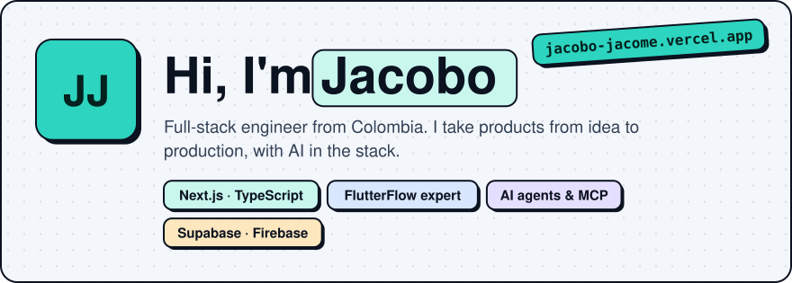</picture></a>

<a href="https://www.linkedin.com/in/jacobo-j%C3%A1come-5bab44213/"><picture><source media="(prefers-color-scheme: dark)" srcset="assets/badge-li-dark.svg"></picture></a>
<a href="mailto:jacobojacome@gmail.com"><picture><source media="(prefers-color-scheme: dark)" srcset="assets/badge-mail-dark.svg"></picture></a>
<a href="https://jacobo-jacome.vercel.app"><picture><source media="(prefers-color-scheme: dark)" srcset="assets/badge-site-dark.svg"></picture></a>

<picture><source media="(max-width: 600px) and (prefers-color-scheme: dark)" srcset="assets/github-phone-dark.svg"><source media="(max-width: 600px)" srcset="assets/github-phone-light.svg"><source media="(prefers-color-scheme: dark)" srcset="assets/github-dark.svg">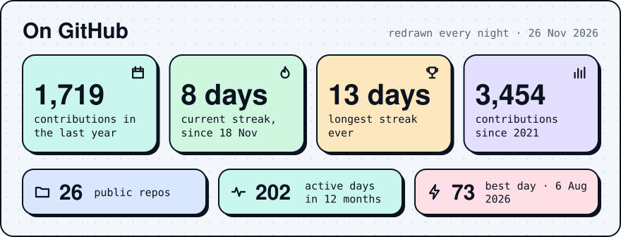</picture>

<picture><source media="(max-width: 600px) and (prefers-color-scheme: dark)" srcset="assets/graph-6m-phone-dark.svg"><source media="(max-width: 600px)" srcset="assets/graph-6m-phone-light.svg"><source media="(prefers-color-scheme: dark)" srcset="assets/graph-6m-dark.svg">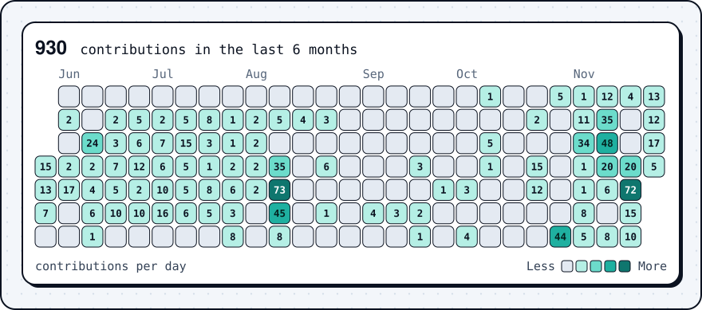</picture>

<b>Last 12 months</b>

<picture><source media="(max-width: 600px) and (prefers-color-scheme: dark)" srcset="assets/graph-12m-phone-dark.svg"><source media="(max-width: 600px)" srcset="assets/graph-12m-phone-light.svg"><source media="(prefers-color-scheme: dark)" srcset="assets/graph-12m-dark.svg">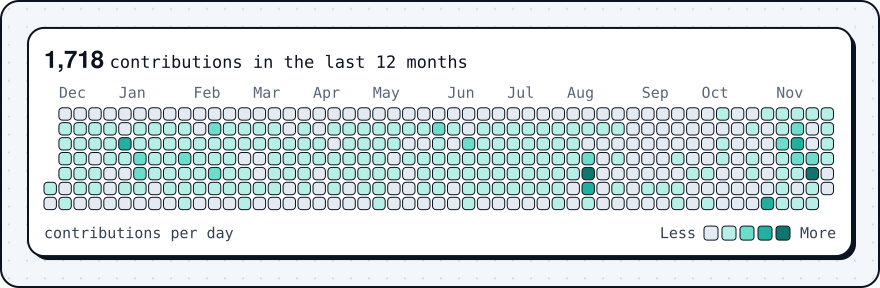</picture>

<b>2026</b> · 1,568 contributions

<picture><source media="(max-width: 600px) and (prefers-color-scheme: dark)" srcset="assets/graph-2026-phone-dark.svg"><source media="(max-width: 600px)" srcset="assets/graph-2026-phone-light.svg"><source media="(prefers-color-scheme: dark)" srcset="assets/graph-2026-dark.svg">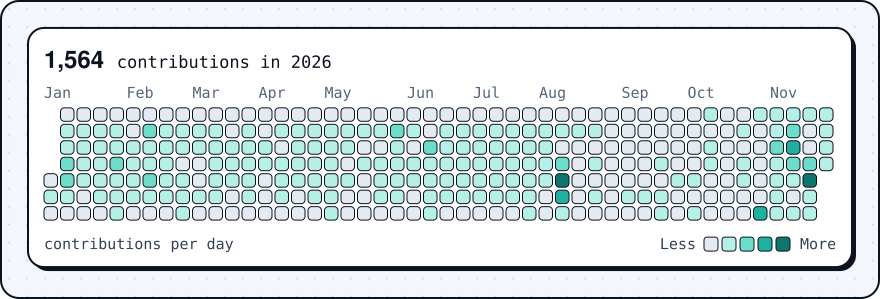</picture>

<b>2025</b> · 991 contributions

<picture><source media="(max-width: 600px) and (prefers-color-scheme: dark)" srcset="assets/graph-2025-phone-dark.svg"><source media="(max-width: 600px)" srcset="assets/graph-2025-phone-light.svg"><source media="(prefers-color-scheme: dark)" srcset="assets/graph-2025-dark.svg">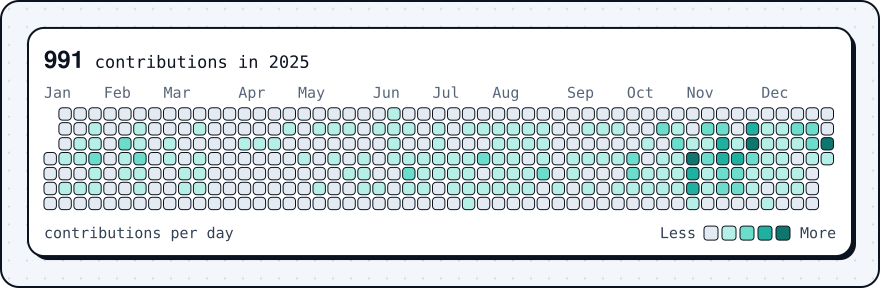</picture>

<b>2024</b> · 425 contributions

<picture><source media="(max-width: 600px) and (prefers-color-scheme: dark)" srcset="assets/graph-2024-phone-dark.svg"><source media="(max-width: 600px)" srcset="assets/graph-2024-phone-light.svg"><source media="(prefers-color-scheme: dark)" srcset="assets/graph-2024-dark.svg">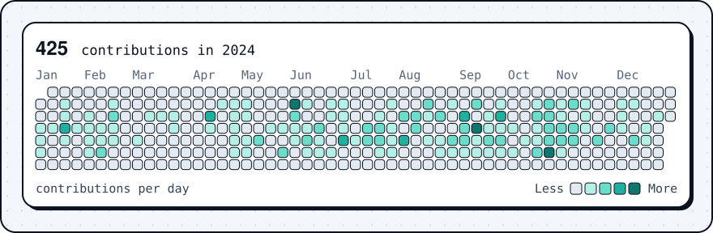</picture>

<b>2023</b> · 334 contributions

<picture><source media="(max-width: 600px) and (prefers-color-scheme: dark)" srcset="assets/graph-2023-phone-dark.svg"><source media="(max-width: 600px)" srcset="assets/graph-2023-phone-light.svg"><source media="(prefers-color-scheme: dark)" srcset="assets/graph-2023-dark.svg">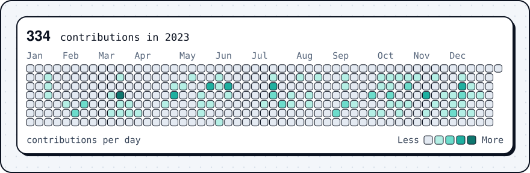</picture>

<b>2022</b> · 86 contributions

<picture><source media="(max-width: 600px) and (prefers-color-scheme: dark)" srcset="assets/graph-2022-phone-dark.svg"><source media="(max-width: 600px)" srcset="assets/graph-2022-phone-light.svg"><source media="(prefers-color-scheme: dark)" srcset="assets/graph-2022-dark.svg">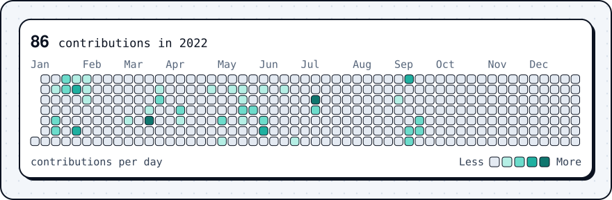</picture>

<b>2021</b> · 50 contributions

<picture><source media="(max-width: 600px) and (prefers-color-scheme: dark)" srcset="assets/graph-2021-phone-dark.svg"><source media="(max-width: 600px)" srcset="assets/graph-2021-phone-light.svg"><source media="(prefers-color-scheme: dark)" srcset="assets/graph-2021-dark.svg">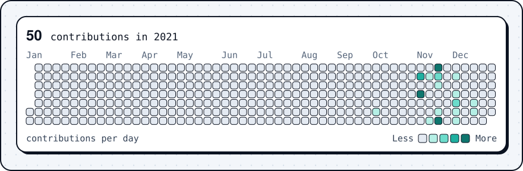</picture>

<picture><source media="(max-width: 600px) and (prefers-color-scheme: dark)" srcset="assets/line-30d-phone-dark.svg"><source media="(max-width: 600px)" srcset="assets/line-30d-phone-light.svg"><source media="(prefers-color-scheme: dark)" srcset="assets/line-30d-dark.svg">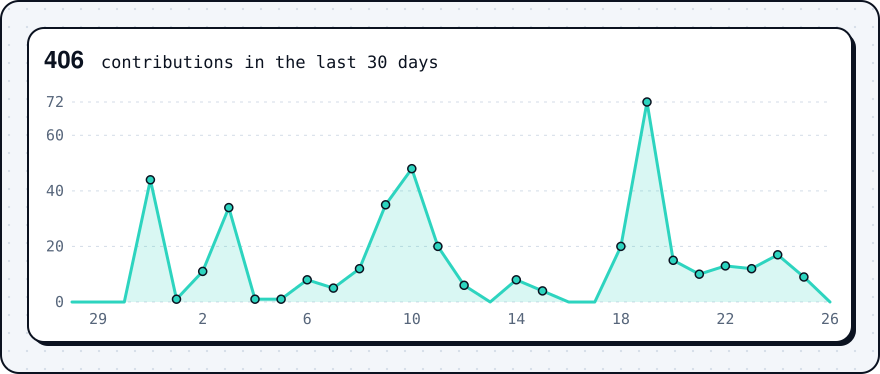</picture>

<picture><source media="(max-width: 600px) and (prefers-color-scheme: dark)" srcset="assets/whoami-phone-dark.svg"><source media="(max-width: 600px)" srcset="assets/whoami-phone-light.svg"><source media="(prefers-color-scheme: dark)" srcset="assets/whoami-dark.svg">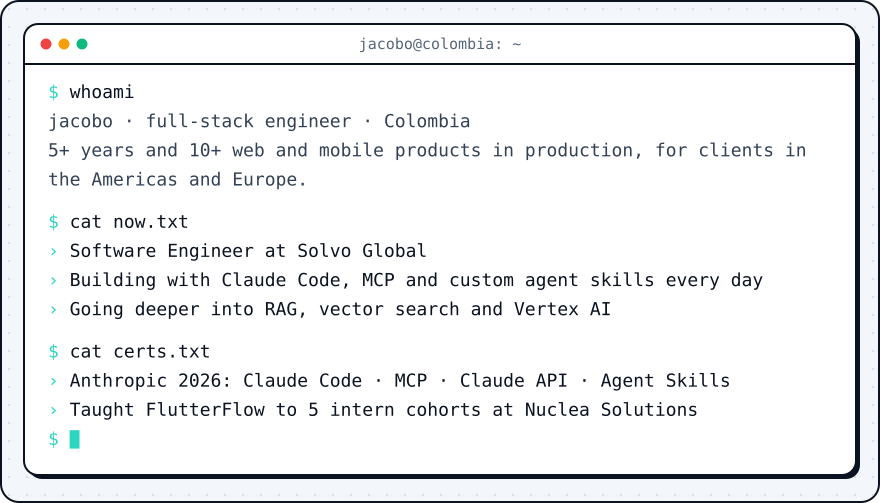</picture>

<picture><source media="(max-width: 600px) and (prefers-color-scheme: dark)" srcset="assets/toolbox-phone-dark.svg"><source media="(max-width: 600px)" srcset="assets/toolbox-phone-light.svg"><source media="(prefers-color-scheme: dark)" srcset="assets/toolbox-dark.svg">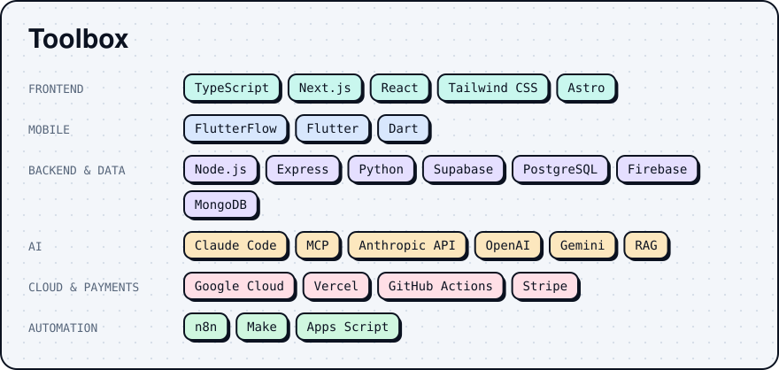</picture>

<picture><source media="(max-width: 600px) and (prefers-color-scheme: dark)" srcset="assets/label-ship-phone-dark.svg"><source media="(max-width: 600px)" srcset="assets/label-ship-phone-light.svg"><source media="(prefers-color-scheme: dark)" srcset="assets/label-ship-dark.svg"></picture>

<a href="https://casa-de-oracion.vercel.app"><picture><source media="(max-width: 600px) and (prefers-color-scheme: dark)" srcset="assets/app-casa-de-oracion-phone-dark.svg"><source media="(max-width: 600px)" srcset="assets/app-casa-de-oracion-phone-light.svg"><source media="(prefers-color-scheme: dark)" srcset="assets/app-casa-de-oracion-dark.svg">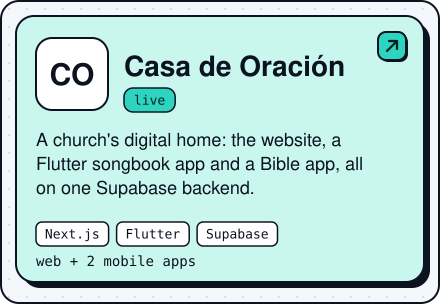</picture></a>
<picture><source media="(max-width: 600px) and (prefers-color-scheme: dark)" srcset="assets/app-oleo-phone-dark.svg"><source media="(max-width: 600px)" srcset="assets/app-oleo-phone-light.svg"><source media="(prefers-color-scheme: dark)" srcset="assets/app-oleo-dark.svg">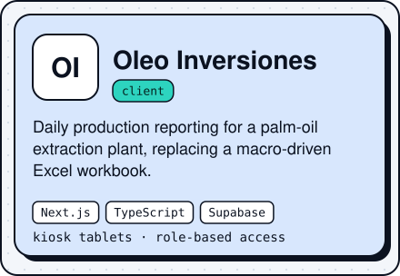</picture>

<picture><source media="(max-width: 600px) and (prefers-color-scheme: dark)" srcset="assets/app-comanda-phone-dark.svg"><source media="(max-width: 600px)" srcset="assets/app-comanda-phone-light.svg"><source media="(prefers-color-scheme: dark)" srcset="assets/app-comanda-dark.svg">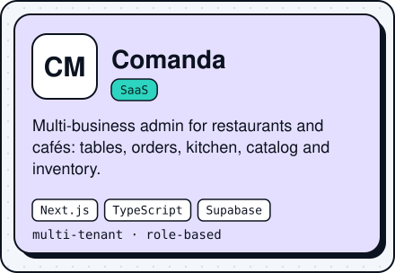</picture>
<picture><source media="(max-width: 600px) and (prefers-color-scheme: dark)" srcset="assets/app-trazored-phone-dark.svg"><source media="(max-width: 600px)" srcset="assets/app-trazored-phone-light.svg"><source media="(prefers-color-scheme: dark)" srcset="assets/app-trazored-dark.svg">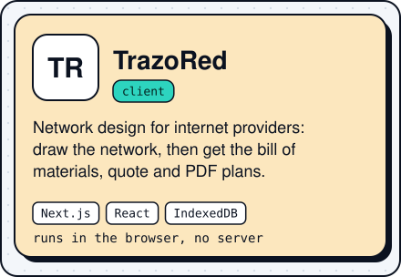</picture>

<picture><source media="(max-width: 600px) and (prefers-color-scheme: dark)" srcset="assets/app-moviltransporte-phone-dark.svg"><source media="(max-width: 600px)" srcset="assets/app-moviltransporte-phone-light.svg"><source media="(prefers-color-scheme: dark)" srcset="assets/app-moviltransporte-dark.svg">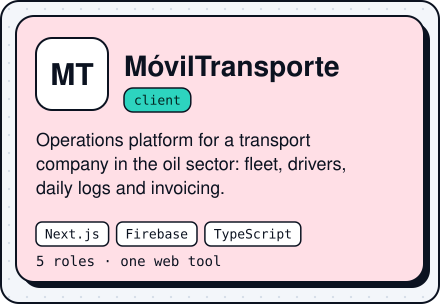</picture>
<picture><source media="(max-width: 600px) and (prefers-color-scheme: dark)" srcset="assets/app-datapalm-phone-dark.svg"><source media="(max-width: 600px)" srcset="assets/app-datapalm-phone-light.svg"><source media="(prefers-color-scheme: dark)" srcset="assets/app-datapalm-dark.svg">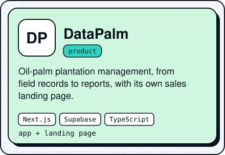</picture>

Client projects live in private repositories, so only a summary is shown here. Every card here is an SVG drawn by <code>scripts/build.py</code> from public GitHub data and redrawn every night by a GitHub Action.

